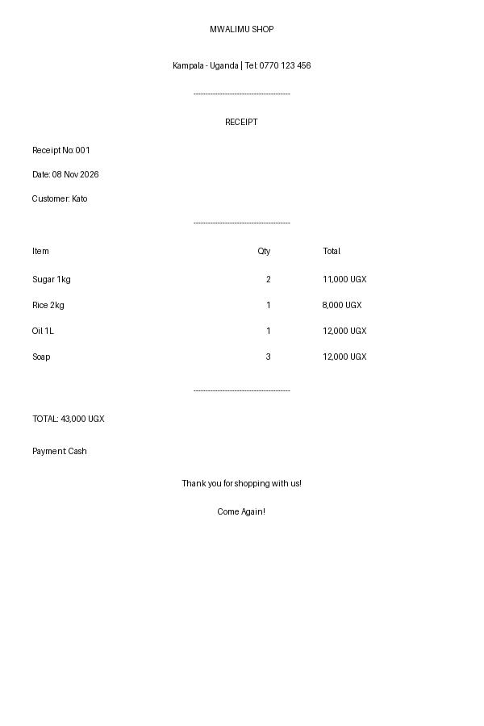

# Hi, I'm Bazil Pedran 👋 - Python Developer from Kampala, Uganda

I build simple Python tools that help small shops, schools, hospitals and all businesses in Uganda save time and make money.

Built with Python + Pillow, all coded on my phone in Termux.

## My Projects

### 1. Receipt Maker 🧾
**Problem:** Shops in Kampala write receipts by hand - slow and messy.
**Solution:** Type customer name + items, it makes a clean PDF receipt in 2 seconds.
**Made with:** Python + Pillow
**File:** `receipt2.py`


### 2. Birthday Photo Maker 🎂
**Problem:** People want nice birthday photos with their name.
**Solution:** Python adds name + decorations to any photo automatically.

### 3. Coming Soon...
- School Report Card Maker
- Stock Tracker for Shops
- Hospital Receipt System

## How to Run My Code
```bash
python receipt2.py
